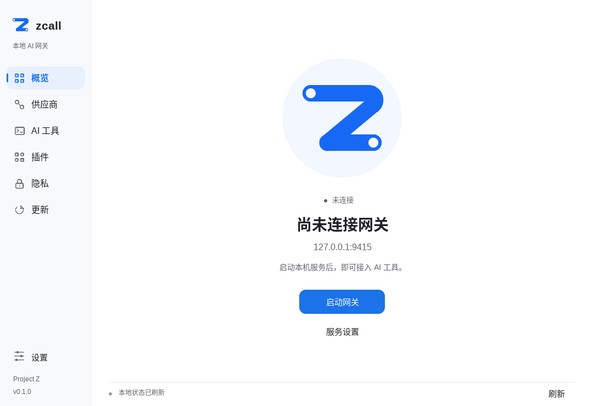
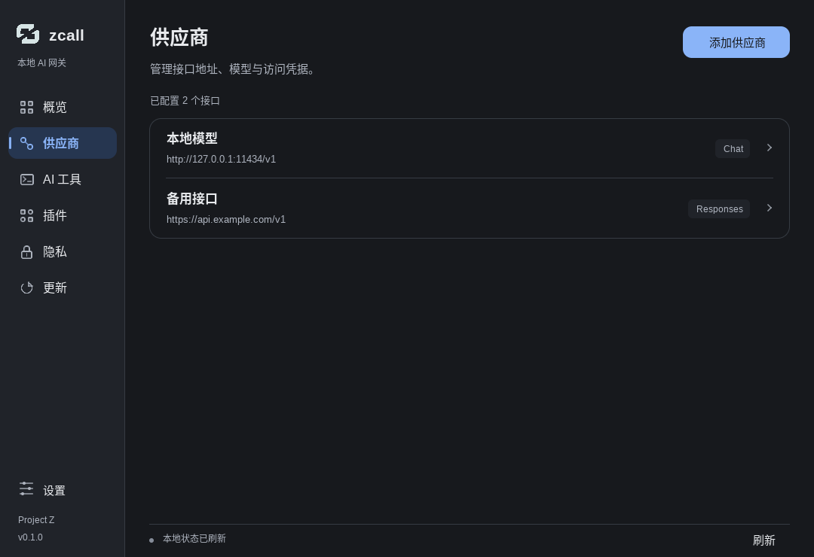

# zcall-gui

zcall-gui is an optional native control panel for [zcalld](https://github.com/LIghtJUNction/zcalld). It manages providers, AI tool settings, plugins, privacy rules, service state and updates by calling the installed `zcalld --json` interface. Closing the window leaves the gateway service running.

The application uses [zgpui](https://github.com/LIghtJUNction/zgpui) 0.1.4 as a pinned Git submodule at `vendor/zgpui`. Cargo resolves only these two first-party packages; the GUI enables the toolkit's `native` feature and imports `zgpui::native`. Window creation, input, fonts and OpenGL use platform libraries; there is no embedded browser or third-party Rust crate.

## Build and run

```sh
git clone --recurse-submodules https://github.com/LIghtJUNction/zcall-gui.git
cd zcall-gui
cargo build --release --offline
./target/release/zcall-gui
```

Rust 1.100 and a native C compiler are required. On Arch Linux, install `base-devel rust pkgconf libx11 libgl freetype2 fontconfig`. On Ubuntu/Debian, install `build-essential pkg-config libx11-dev libgl1-mesa-dev libfreetype6-dev libfontconfig1-dev`. Linux Wayland sessions use XWayland.

The gateway is a separate installation; management commands require zcalld 0.2.0 or newer. Use `zcall-gui --zcalld /absolute/path/to/zcalld --config /path/to/config.conf` to select a custom CLI or configuration. If the CLI is absent or an operation fails, the application displays the error; it does not silently create a second gateway.

## Controls

- **Overview:** see the gateway state and one next step: add a provider or connect your AI tools. Click either count to open its list; service controls stay in Service settings.
- **Providers:** add or update an endpoint, select a protocol, set a default model, test it, or remove it. API keys are masked and sent to the CLI through stdin.
- **AI tools:** detect supported tools, apply a gateway route, or revert an earlier configuration change.
- **Plugins:** inspect enabled state, install a local library or pinned remote source, enable/disable, update or remove a plugin. Newly installed native code requires a separate enable action.
- **Privacy:** select off, secret sanitization, or secret plus personal information sanitization.
- **Updates:** check and apply gateway or GUI updates.

Tab / Shift+Tab move focus, Enter activates buttons, Ctrl+A selects an input, and standard copy/paste shortcuts work. Ctrl+Q closes the GUI. Provider rows open details on demand. Adding an endpoint uses two short steps; removal stays in the detail panel.

## Appearance and language

The window uses the Ink palette from [oh-my-ztty](https://github.com/LIghtJUNction/oh-my-ztty/tree/6d95c7eaa1a4ef27df2ae246edd7bddde5f3b31b): warm dark surfaces, copper accents and a matching cream light palette. Controls, input focus and status colors use the same application-local palette. The window prefers JetBrains Mono when installed and falls back to the platform monospace family, retaining native glyph fallback. It does not install fonts or change desktop fonts or other applications.

Open Settings at the lower left to select System, Light or Dark, and System, Simplified Chinese, Traditional Chinese, English or Japanese. Choices are stored locally and restored on the next launch. System preferences are read at launch and when opening Settings; there is no background desktop-preference polling.

Language strings live in four complete catalogs under resources/locales. Tests check matching keys and locale fallback. An explicit session override is also available:

~~~sh
zcall-gui --theme dark --language ja
~~~

The previews use synthetic local configuration in a private native window.





## Updates

```sh
zcall-gui --update check
zcall-gui --update apply
```

The updater downloads only the official stable GitHub release for the current platform, checks SHA-256 and the staged executable's version, retains one previous binary, then replaces the installed executable. A user-writable installation can update in place. For an AUR installation, the Updates page opens a native terminal with paru or yay, preserves the installed source or binary package, and reports the actual completion result. The terminal retains normal package review and authorization.

Linux and macOS keep the current process alive until you close it and open the new version. Windows uses a small deferred helper after the current process exits. The current first implementation is unsigned; Windows/macOS may require their normal downloaded-application approval.

## Releases and packages

Published binaries and archives are available through [GitHub Releases](https://github.com/LIghtJUNction/zcall-gui/releases). Arch recipes are zcall-gui (source) and zcall-gui-bin (binary), both requiring zcalld 0.2.0 or newer. [Release and installation instructions](docs/RELEASING.md) cover AUR, portable archives, staged installs and the patch-bump workflow.

## Development and evidence

Daily checks run locally:

```sh
cargo fmt --check
cargo clippy --all-targets -- -D warnings
cargo test
cargo build --release --offline
xvfb-run -a -s '-screen 0 1100x740x24 -nolisten tcp' python3 scripts/ui_smoke.py
```

The Linux GUI has been opened on an Intel UHD GPU. The real-window test uses an isolated Xvfb display. It exercises provider stdin credentials, agent route changes, plugin activation, privacy selection and update checks against a local fixture. A separate run uses the actual developing zcalld CLI and an isolated home to verify saved providers, agent apply/restore, privacy changes and appearance persistence. Neither run calls a remote model. Screenshots contain isolated test configuration. [Validation evidence](docs/VALIDATION.md) records the scope and current limits.

The native backend currently uses X11/GLX on Linux, Win32/WGL on Windows and Cocoa/OpenGL on macOS. Apple has [deprecated OpenGL](https://developer.apple.com/documentation/appkit/nsopenglcontext); there is no Metal or native Wayland backend in this version. Native screen-reader accessibility and complex-script shaping are also not implemented.

License: [MIT](LICENSE).

[Dependency propagation](docs/DEPENDENCIES.md) records the frozen shared-library snapshot and downstream ownership.
